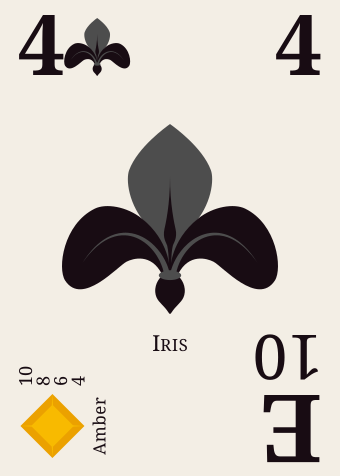
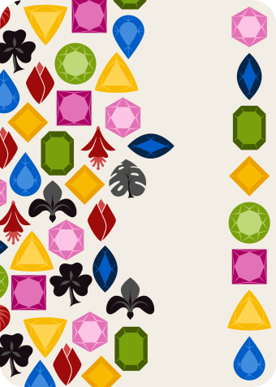

# Multipack

104-card deck encoding playing cards, Lexicon, plants, and Bohnanza gems.

  
  

**Face**

- **Top left**: rank and suit plant. Red suits print in red.
- **Top right**: card number, 1–104 (clubs, diamonds, hearts, spades, ace to king; 53–104 is the second copy).
- **Centre**: plant and its name in small caps. Iris ♣, Tulip ♦, Hosta ♥ and Monstera ♠ on 1–52; Clover ♣, Fuchsia ♦, Eastern Redbud ♥ and Anthurium ♠ on 53–104.
- **Bottom left**: gem, name and beanometer (beans for 4→1 coins). Gems map Bohnanza's beans: Amber 20 (blue), Topaz 18 (chili), Peridot 16 (stink), Quartz 14 (green), Citrine 12 (soy), Sapphire 10 (black-eyed), Emerald 8 (red), Ruby 6 (garden).
- **Bottom right**: Lexicon letter and value, printed upside down. Turn the card round to play Lexicon and they read as a normal corner index. Each copy holds a standard 52-card Lexicon deck (★ is the wild master card).

**Back**: `designs/Card back.svg`, embedded as drawn.

Design sources live in `designs/`: symbol library, card back, mockups, palette and the Linux Biolinum font (OFL).

## Credits

Card artwork (plant and gem illustrations, card back, palette and layout) by **Janet Bell**. © 2026 Janet Bell, all rights reserved. The artwork is not open source and may not be copied, printed or reused without her written permission. See [ARTWORK-LICENSE.md](ARTWORK-LICENSE.md).

Code: [MIT](LICENSE). The MIT licence covers the code only, not the artwork.

Typeface: [Linux Biolinum](https://sourceforge.net/projects/linuxlibertine/) by the Libertine Open Fonts Project, under the SIL Open Font License.

## Scripts

- `npm run dev` — viewer (`/`, `/print`)
- `npm test` — encoding fixtures
- `npm run generate:mapping` — regenerate `src/deck/deck-mapping.json` / `.csv`
- `npm run extract:symbols` — regenerate `src/assets/symbol-data.ts` and `card-back-data.ts` from `designs/`
- `npm run generate:readme-images` — regenerate `docs/face.svg` and `docs/back.svg`
- `npm run export` — SVG faces + back in `export/`
  - `--dpi 300` scales by 2.205 (750×1050)
  - `--bleed 3mm` adds bleed outside the card box
- `npm run export:mpc` — MakePlayingCards pack in `export/mpc/`
  - 104 faces + back as 822×1122 PNG (300 dpi, 36 px bleed)
  - `multipack.pdf` is a 105-page proof; upload the PNGs
  - Product: Custom Game Cards, Traditional Poker, up to 108 cards
